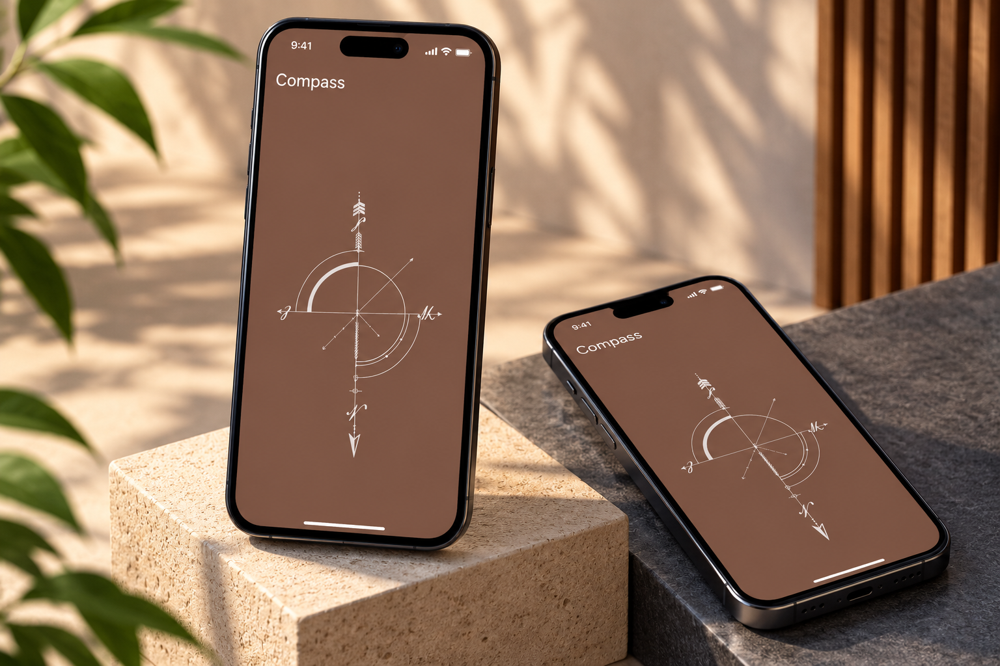

<div align="center">

# 🧭 Compass App

### Flutter • Dart • Mobile Sensors

A modern digital compass application built with
**Flutter and Dart**, featuring a clean interface
for displaying compass directions and orientation.


</div>

---

## 📸 Project Preview

<div align="center">

<a href="0ac35596-5c05-4512-a333-f77c81921583.png">
  
</a>

</div>

---

## 📖 About the Project

**Compass App** is a Flutter-based mobile
application designed to display directional
information through a simple and intuitive
digital compass interface.

The project focuses on building a practical
mobile utility while exploring Flutter UI
development and device orientation concepts.

The application is designed to help users
identify compass directions through a
clear visual interface.

---

## ✨ Key Features

### 🧭 Digital Compass

- Compass direction display.
- North, South, East, and West indicators.
- Visual compass interface.
- Device orientation presentation.

### 📐 Direction & Orientation

- Heading information display.
- Compass rotation interface.
- Directional navigation visualization.

### 🎨 User Interface

- Modern Flutter design.
- Clear compass indicators.
- Minimal navigation.
- Responsive mobile layouts.
- Easy-to-read directional information.

---

## 🛠️ Technologies Used

| Technology | Purpose |
|------------|---------|
| Flutter | Mobile application UI |
| Dart | Application logic |
| Material Design | UI components |
| Device Sensors | Orientation data, if supported |
| Git | Version control |
| GitHub | Source code hosting |

---

## 🏗️ Application Overview

```text
         Compass App
              |
              v
        Flutter UI
              |
              v
      Orientation Data
              |
              v
      Heading Calculation
              |
              v
      Compass Visualization
```

---

## 🧭 How a Digital Compass Works

A digital compass typically uses a device's
magnetometer and other motion sensors to
estimate its orientation relative to
magnetic north.

The heading is expressed in degrees:

| Heading | Direction |
|---------|-----------|
| 0° / 360° | North |
| 90° | East |
| 180° | South |
| 270° | West |

If the application uses live sensor readings,
the compass interface can update as the
device rotates.

Compass accuracy depends on the device's
sensor hardware, calibration, and nearby
magnetic interference.

---

## 🚀 Getting Started

### Prerequisites

Make sure you have installed:

- Flutter SDK
- Dart SDK
- Android Studio or VS Code
- Git
- A compatible mobile device for sensor testing

### 1. Clone the Repository

```bash
git clone <YOUR_COMPASS_REPOSITORY_URL>
```

Replace the placeholder with your actual
GitHub repository URL.

### 2. Open the Project

```bash
cd <YOUR_PROJECT_FOLDER>
```

### 3. Install Dependencies

```bash
flutter pub get
```

### 4. Run the Application

```bash
flutter run
```

### 5. Test the Compass

For an application using live compass data:

1. Run it on a physical device.
2. Rotate the device slowly.
3. Observe the compass heading.
4. Verify the directional indicators.
5. Calibrate the device if readings are inaccurate.

Some devices and emulators do not provide
reliable magnetometer readings.

---

## 💡 Development Highlights

This project explores:

- Flutter mobile UI development.
- Digital compass interface design.
- Device orientation concepts.
- Directional data visualization.
- Responsive layout development.
- Mobile utility application design.

---

## 🎯 Project Goals

- Build a simple digital compass application.
- Present directional information clearly.
- Explore device orientation capabilities.
- Create a responsive Flutter interface.
- Develop a practical mobile utility.

---

## 👨‍💻 Developer

**Ahmed Jaber Ahmed**

Flutter Developer | Mobile App Developer

B.Sc. Computer Science & Artificial Intelligence

📍 Cairo, Egypt

- [GitHub](https://github.com/AhmedJaberAhmed)
- [Portfolio](https://ahmedjaberahmed.github.io/Jaber-website/)
- [LinkedIn](https://www.linkedin.com/in/ahmedjaberahmed/)

---

<div align="center">

### ⭐ Support the Project

If you find this project useful,
consider giving it a star!

**Built with Flutter 💙**

</div>
